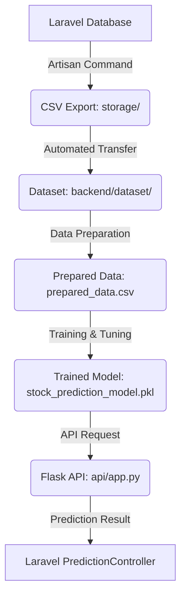

# Panduan Alur Backend (Backend System Flow)

Dokumen ini menjelaskan alur kerja sistem backend, mulai dari pengambilan data hingga prediksi stok obat.

## 1. Ringkasan Alur Kerja

Backend Python bekerja sebagai unit pemroses Machine Learning yang menerima data dari Laravel, memprosesnya, melatih model, dan menyajikan API untuk prediksi.

## 2. Penjelasan File dan Fungsinya

Berikut adalah pemetaan file berdasarkan peran fungsionalnya:

### A. Persiapan Data (EDA & Cleaning)
*   **File**: `dataset/data_preparation.py`
*   **Fungsi**: File ini bertanggung jawab untuk membaca data mentah dari hasil export Laravel, melakukan pembersihan data (*data cleaning*), menangani *missing values*, serta melakukan *Feature Engineering*. Ini adalah tempat di mana **EDA (Exploratory Data Analysis)** dilakukan secara logis sebelum data digunakan untuk pelatihan.

### B. Pelatihan & Splitting Model
*   **File**: `notebook/model_trainer.py`
*   **Fungsi**: Ini adalah otak dari proses pelatihan.
    *   **Splitting**: Melakukan pembagian data menjadi *Training Set* (data untuk belajar) dan *Test Set* (data untuk ujian model) dengan mempertimbangkan urutan waktu.
    *   **Training**: Menggunakan algoritma *Decision Tree Regressor* (CARD Method).
    *   **Optimization**: Menggunakan `GridSearchCV` untuk mencari parameter terbaik (*Hyperparameter Tuning*).
    *   **Evaluation**: Menghitung metrik (MAE, RMSE, R²).

### C. Eksekusi & Automasi Pipeline
*   **File**: `app.py`
*   **Fungsi**: File utama (*main*) yang mengorkestrasi seluruh proses. File ini memanggil fungsi dari `data_preparation.py` dan `model_trainer.py` sesuai perintah pengguna (export data, prepare, train, atau run API).

### D. Prediksi (Model Deployment)
*   **File**: `api/app.py`
*   **Fungsi**: Berjalan sebagai server Flask. File ini memuat model yang sudah dilatih (`stock_prediction_model.pkl`) ke dalam memori dan menyajikan endpoint REST API (seperti `/predict`) yang dipanggil oleh Laravel.

### E. Analisis & Dashboard
*   **File**: `streamlit_app.py`
*   **Fungsi**: Menyajikan visualisasi interaktif. Di sini, Anda bisa melihat performa model, matriks korelasi, pentingnya fitur, dan melakukan prediksi secara langsung untuk testing.

---

## 3. Alur Proses Monthly Maintenance (Pemeliharaan)

Setiap bulan, untuk memastikan model tetap relevan, jalankan alur berikut melalui terminal:

1.  **Ekspor Data Baru**: `php artisan prediksi:export-data --months=12` (di sisi Laravel).
2.  **Jalankan Pipeline Lengkap**: `python app.py --full --months=12` (di sisi Backend).
    *   Proses ini akan mengotomatisasi pemindahan file, pembersihan data, pelatihan ulang model, dan penyimpanan model baru secara otomatis.
3.  **Monitoring**: Buka `streamlit run streamlit_app.py` untuk memverifikasi apakah metrik akurasi (`R² score`) masih dalam batas aman (di atas 0.7 - 0.8).

---
*Jika ada bagian dari alur ini yang ingin didiskusikan lebih lanjut, silakan bertanya.*
